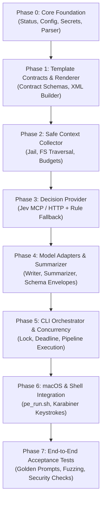

# Agent Implementation Guide

**Audience**: AI Coding Agents implementing the Prompt Enhancement Engine.  
**Purpose**: Step-by-step architectural execution blueprint, crate contracts, trait definitions, and verification criteria.

---

## 1. Implementation Roadmap

Implementation must proceed in strict phased increments. Each phase is self-contained, unit-tested, and verified before the next phase begins.



---

## 2. Workspace Crate Architecture

The system is partitioned into four workspace crates under `crates/`:

### 2.1 `crates/core` (`pe-core`)
**Dependencies**: `serde`, `serde_json`, `toml`, `thiserror`, `regex`, `lazy_static` / `once_cell`.
- **Status & Exit Codes**: Enums for `EvidenceStatus`, `TerminalStatus`, and `ExitClass` (`architecture.md` §4, `workflow-integration.md` §4).
- **Configuration**: Strongly typed `Config` struct (budgets, model endpoints, timeouts, exclusions). Resolution priority:
  1. CLI arguments / env flags
  2. `~/.config/prompt_enhancer/config.toml`
  3. Bundled compiled-in defaults.
- **Input Parser**:
  - Empty / whitespace detector (`INPUT_EMPTY`).
  - Stale clarification sentinel check (`[[PE-CLARIFY-v1:BEGIN]]`).
  - Line 1 `~/` project root extractor (`workflow-integration.md` §7).
  - Opaque block extractor: Extracts ` ``` ` / `~~~` code and log blocks, replacing them with indexed tokens (`[[OPAQUE_BLOCK_n]]`) so they are preserved byte-identical.
- **Secret Redaction & Placeholder Map**:
  - High-precision regex / Shannon entropy detection for API keys, bearer tokens, private keys, connection strings.
  - Generates stable opaque placeholders: `[[SECRET_PE_<UUID>]]`.
  - Maintains in-memory bidirectional map to restore secrets in the rendered output.
- **Template Contracts & XML Renderer**:
  - Hand-written Rust schemas for each of the 15 templates (`templates/README.md`).
  - Distinguishes dynamic variable fields (`task`, `acceptance_criteria`, etc.) from hardcoded sections (`rules`, `verify`, `report`, `scope > out_of_scope`).
  - Assembles and validates well-formed XML output.

### 2.2 `crates/context` (`pe-context`)
**Dependencies**: `pe-core`, `walkdir`, `globset`, `sha2`.
- **Jail & Path Security** (D-018):
  - Canonicalizes project root using `std::fs::canonicalize`.
  - Every prospective read re-canonicalizes the target path and verifies `target.starts_with(&canonical_root)`. Symlinks resolving outside the root return `SAFETY_BLOCKED`.
- **Exclusion Engine**:
  - Default denylists: `.git`, `node_modules`, `target`, `.env*`, `*.pem`, `*.key`, binary files, build artifacts.
- **Candidate Discovery & Inspected Set**:
  - Stable IDs for candidate files.
  - Tracking set of inspected file IDs to prevent collection loops (`context-collection.md` §5).
- **Field-Driven Collector**:
  - Driven by the selected template's `evidence_allowed` fields.
  - Profiles: `none`, `targeted_file`, `bug_context`, `architecture_context`, `test_context`, `configuration_context`.
- **Budget Monitor**:
  - Hard upper limits on files inspected, bytes read, token estimates, iterations, and wall-clock duration (`BUDGET_EXHAUSTED`).
- **Evidence Bundle Builder**:
  - Constructs internal view and sanitized model-facing view (`evidence-bundle.md` §7).
  - Enforces provenance: file path, line range, content hash, modification timestamp.

### 2.3 `crates/adapters` (`pe-adapters`)
**Dependencies**: `pe-core`, `pe-context`, `reqwest` (or native HTTP client), `async-trait`.
- **Decision Provider Trait**:
  - Jev Adapter: Communicates with Jev service (`jev_classify_choice` for template routing, `jev_evaluate_noul` for context necessity).
  - Rule Fallback: Deterministic keyword and pattern matching rules.
  - Automatic fallback on network failure, timeout, or low confidence, asserting the `JEV_DEGRADED` flag.
- **Prompt Writer Adapter**:
  - Generic LLM client (OpenAI-compatible / Anthropic / local endpoints).
  - Sends master prompt (`prompts/master-prompt.md`), task text with placeholders, template contract, and model-facing evidence bundle.
  - Expects JSON envelope: `{ "status": "OK", "fields": { ... } }` or `{ "status": "NEEDS_CLARIFICATION", "question": "...", "blocking_reason": "..." }`.
  - Automatic schema validation and bounded retry (max 1 retry).
- **Context Summarizer Adapter**:
  - Condenses large evidence bundles into structured facts when token budgets are exceeded (`D-006`).
  - Output classified strictly as `derived_summary`, never `direct_observation`.

### 2.4 `crates/cli` (`pe-cli`)
**Dependencies**: `pe-core`, `pe-context`, `pe-adapters`, `tokio`, `clap`.
- **Single-Flight Lock**:
  - User-private lockfile (`~/.local/state/prompt_enhancer/pe.lock` or macOS runtime dir).
  - Acquires exclusive lock or exits immediately with status `BUSY` (exit code `3`).
  - Detects dead/stale PID and safely reclaims lock.
- **Deadline Supervisor**:
  - Top-level `tokio::time::timeout` wrapping the entire pipeline.
  - On timeout: cancels pending futures, releases lock, emits `DEADLINE_EXCEEDED` on `stderr`, exits code `1`.
- **Pipeline Coordinator**:
  - Implements the 14-step flow from `architecture.md` §3.
  - Formats human-readable status + flags on `stderr`.
  - Emits final XML or clarification block on `stdout`.

---

## 3. Core Rust Traits & Interfaces

```rust
// crates/core/src/traits.rs

use crate::types::*;
use async_trait::async_trait;

/// Template selection and context necessity decider.
#[async_trait]
pub trait DecisionProvider: Send + Sync {
    /// Select the most appropriate template from the 15 available options.
    async fn select_template(&self, task_text: &str) -> Result<DecisionResult<TemplateId>, CoreError>;

    /// Decide whether project context collection is warranted.
    async fn should_collect_context(&self, task_text: &str, template_id: TemplateId) -> Result<DecisionResult<bool>, CoreError>;
}

/// Field-driven local context collector.
#[async_trait]
pub trait ContextCollector: Send + Sync {
    /// Collect evidence bounded by template field needs and budget limits.
    async fn collect(
        &self,
        root: &ValidatedProjectRoot,
        template_id: TemplateId,
        task_text: &str,
        budget: &BudgetConfig,
    ) -> Result<EvidenceBundle, CoreError>;
}

/// External language model adapters.
#[async_trait]
pub trait PromptWriter: Send + Sync {
    /// Request variable field values matching the template contract.
    async fn generate_fields(
        &self,
        task_text: &str,
        template_id: TemplateId,
        evidence: &ModelFacingEvidence,
    ) -> Result<WriterEnvelope, CoreError>;
}

#[async_trait]
pub trait ContextSummarizer: Send + Sync {
    /// Condense oversized evidence items into concise factual statements.
    async fn summarize(
        &self,
        raw_items: &[EvidenceItem],
        target_token_budget: usize,
    ) -> Result<Vec<EvidenceItem>, CoreError>;
}
```

---

## 4. Detailed Step-by-Step Implementation Sequence

### Phase 0: Foundations & Data Models
1. Create root `Cargo.toml` with workspace members: `crates/core`, `crates/context`, `crates/adapters`, `crates/cli`.
2. Define status types in `crates/core/src/status.rs`:
   - `EvidenceStatus`: `NO_COLLECTION`, `SUFFICIENT_CONTEXT`, `NEEDS_CLARIFICATION`, `BUDGET_EXHAUSTED`, etc.
   - `TerminalStatus`: `RENDERED`, `CLARIFICATION_EMITTED`, `BUSY`, `STALE_CLARIFICATION_MARKER`, etc.
   - `ExitCode`: Mapping to 0 (success), 2 (clarification), 3 (busy), 1 (failure).
3. Implement `InputParser` in `crates/core/src/parser.rs`:
   - Check empty/whitespace.
   - Detect `[[PE-CLARIFY-v1:BEGIN]]` header/sentinel.
   - Extract `~/...` first line, expand tilde, canonicalize path.
   - Extract opaque code blocks (` ```...``` `).
4. Implement `SecretScanner` in `crates/core/src/secrets.rs`:
   - Match sensitive tokens (AWS, OpenAI, GitHub tokens, private keys).
   - Substitute with `[[SECRET_PE_<UUID>]]`.
   - Implement `restore_secrets(text: &str, map: &SecretMap) -> String`.
   - Unit test round-trip safety.

### Phase 1: Template Contracts & XML Renderer
1. Create contract representations for all 15 templates in `crates/core/src/templates/`:
   - For each template: define required/optional dynamic fields, allowed collection profile, and hardcoded static XML blocks (`rules`, `verify`, `report`, `out_of_scope`).
2. Build `XmlRenderer` in `crates/core/src/render.rs`:
   - Inject dynamic field values into designated tags.
   - Append hardcoded static sections verbatim from `templates/*.md`.
   - Validate XML balance and escaping before returning output.

### Phase 2: Safe Context Collector & Jail
1. Implement `ProjectJail` in `crates/context/src/jail.rs`:
   - Wrap `PathBuf`.
   - Re-check canonical path containment on every read operation.
   - Ensure symlinks escaping the jail are rejected with `SAFETY_BLOCKED`.
2. Implement `FileScanner` in `crates/context/src/scanner.rs`:
   - In-process file reads only (no subprocess execution).
   - Apply exclusions (`.git`, `node_modules`, binaries).
   - Maintain `inspected_set: HashSet<CandidateId>` to prevent duplicate reads.
3. Implement `BudgetTracker` in `crates/context/src/budget.rs`:
   - Track read bytes, file count, estimated tokens, and collection iterations.
   - Return `BUDGET_EXHAUSTED` when thresholds are reached.

### Phase 3: Decision Provider (Jev + Rule Engine)
1. Implement `RuleDecisionEngine` in `crates/adapters/src/rules.rs`:
   - Keyword matching (e.g. "fix", "error", "bug" → `debug_bugfix`; "refactor", "implement" → `implementation_refactoring`).
   - Serves as the zero-latency, 100% reliable fallback.
2. Implement `JevClient` in `crates/adapters/src/jev.rs`:
   - Integrates with Jev MCP / local HTTP endpoint.
   - Evaluates template classification and context necessity.
   - On error or confidence < threshold (0.75): log warning, emit `JEV_DEGRADED`, and delegate to `RuleDecisionEngine`.

### Phase 4: Model Adapters & Summarizer
1. Define envelope structs in `crates/adapters/src/envelope.rs`:
   - `WriterEnvelope::Success { fields: HashMap<String, String> }`
   - `WriterEnvelope::NeedsClarification { question: String, blocking_reason: String }`
2. Implement `LlmWriter` in `crates/adapters/src/writer.rs`:
   - Generic HTTP adapter supporting JSON Schema mode.
   - Validate response fields against template contract.
   - Retry once on malformed JSON or missing required fields.
3. Implement `LlmSummarizer` in `crates/adapters/src/summarizer.rs`:
   - Triggered only when evidence bundle exceeds token budget.
   - Classifies resulting items as `derived_summary`.

### Phase 5: CLI Orchestrator & Concurrency
1. Implement `SingleFlightLock` in `crates/cli/src/lock.rs`:
   - File lock using `fs2` or Unix flock.
   - If locked, check PID liveness. If live, exit `BUSY` (code 3). If dead, clean up and re-acquire.
2. Implement `DeadlineSupervisor` in `crates/cli/src/main.rs`:
   - Wrap execution in `tokio::time::timeout(Duration::from_millis(10_000), ...)`.
3. Orchestrate full 14-step pipeline:
   - stdin -> parse -> redact -> select -> collect -> summarize -> write -> validate -> restore secrets -> render -> stdout.

### Phase 6: Shell & System Integration
1. Write `scripts/pe_run.sh`:
   - Query frontmost macOS app via AppleScript / `lsappinfo`.
   - Save current clipboard using `pbpaste`.
   - Trigger `Cmd+A` and `Cmd+C` via System Events.
   - Pipe clipboard to `pe` binary.
   - If exit code 0 or 2: verify frontmost app is identical, then paste (`Cmd+V`) and restore previous clipboard.
   - If exit code 3 or failure: notify user, leave editor untouched.
2. Provide Karabiner-Elements JSON snippet binding a shortcut (e.g. `Cmd+Shift+Space`) to `pe_run.sh`.

### Phase 7: Verification & Acceptance Testing
1. Golden Prompt Suite: 15 diverse raw prompts tested end-to-end against all 15 templates.
2. Security Tests:
   - Attempted directory traversal (`~/my_proj/../../etc/passwd`).
   - Symlink pointing outside project root.
   - High-entropy secret strings (ensure never sent to model unredacted).
3. Stale Clarification Test: Verify that running the tool against a prompt containing `[[PE-CLARIFY-v1:BEGIN]]` exits with `STALE_CLARIFICATION_MARKER` without modifying the editor.
4. Concurrency Test: Triggering two simultaneous runs must result in the second run immediately returning `BUSY`.

---

## 5. Implementation Traps & Safeguards

| Component | Potential Trap | Mandatory Safeguard |
|---|---|---|
| **Path Traversal** | Path canonicalization race or relative symlinks escaping root. | Always re-canonicalize at read time and verify `path.starts_with(&root)`. |
| **Secrets** | Model echoes placeholder with slight typo (e.g. `[SECRET_PE_1]`). | Exact UUID token matching; validation fails with `VALIDATION_FAILED` if placeholders are corrupted. |
| **Editor Loss** | Shell pastes half-written or degraded text over user work. | Shell script pastes **only** on exit code 0 (`RENDERED`) or 2 (`CLARIFICATION_EMITTED`). All other codes leave editor untouched. |
| **Lock Abandonment** | Crash or kill signal leaves stale lock file on disk. | Lock file stores PID; check `kill(pid, 0)` before rejecting as `BUSY`. Clean up stale locks. |
| **Context Loops** | Cyclic directory references or repeatedly reading the same file. | Candidate IDs are tracked in `inspected_set: HashSet<CandidateId>`. Hard iteration limit enforced in Rust. |
| **Model Markup** | LLM attempts to emit XML tags directly instead of field values. | System prompt strictly forbids markup; schema validator rejects raw XML tag strings in field values. |
